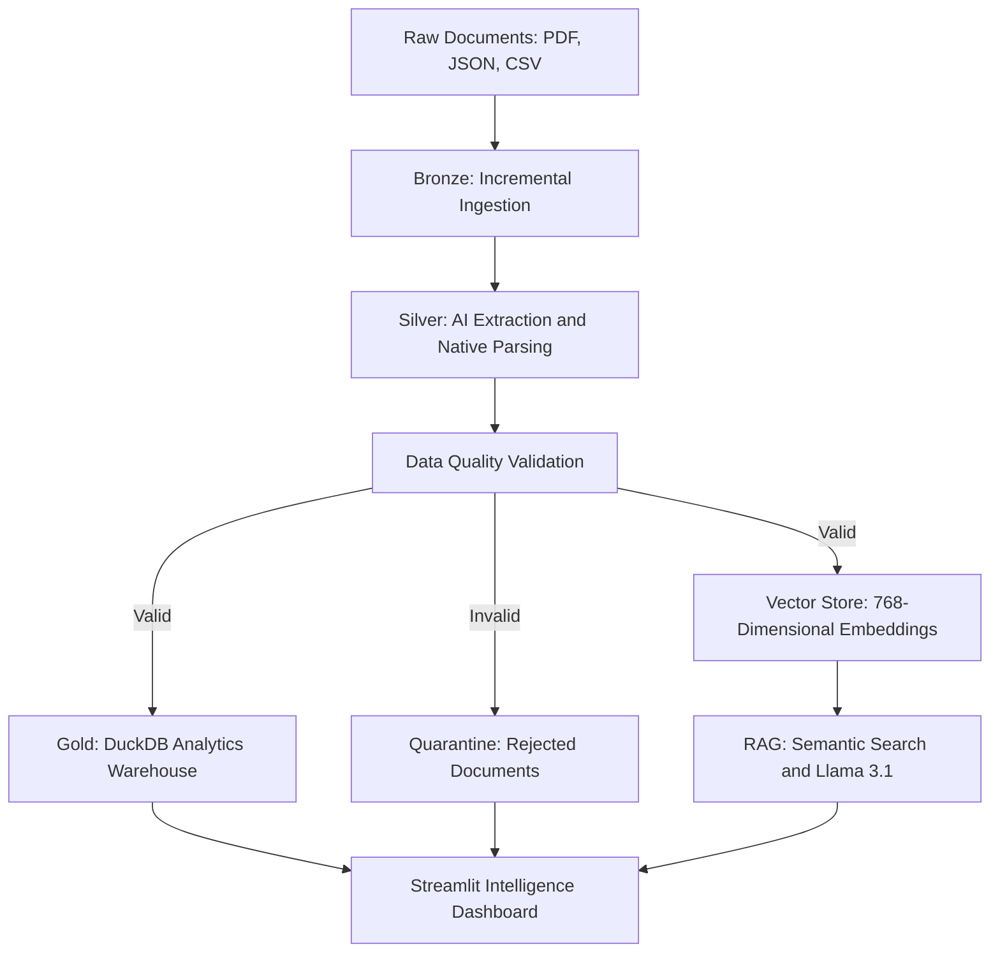
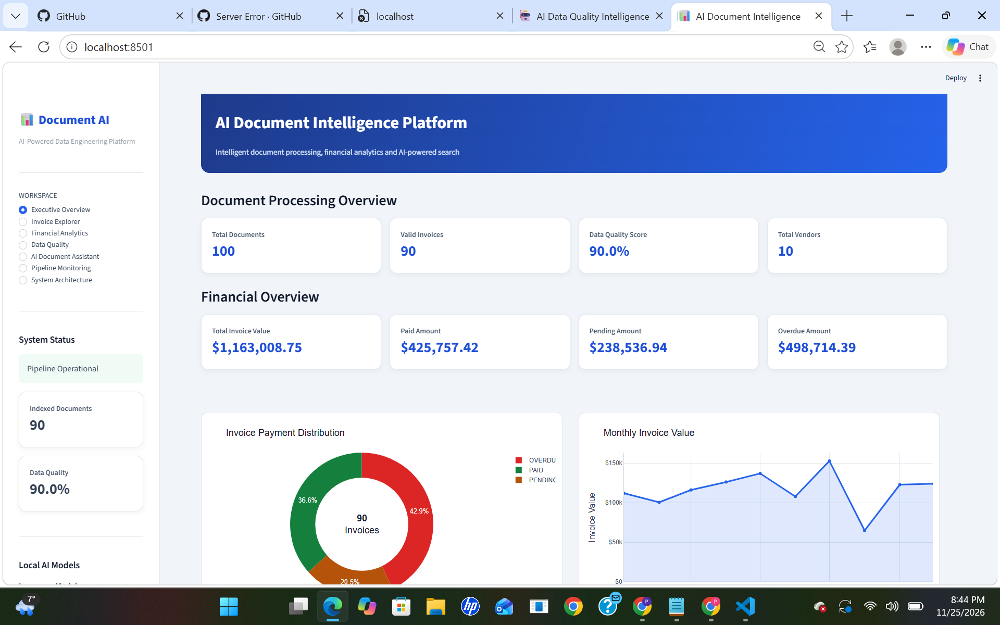
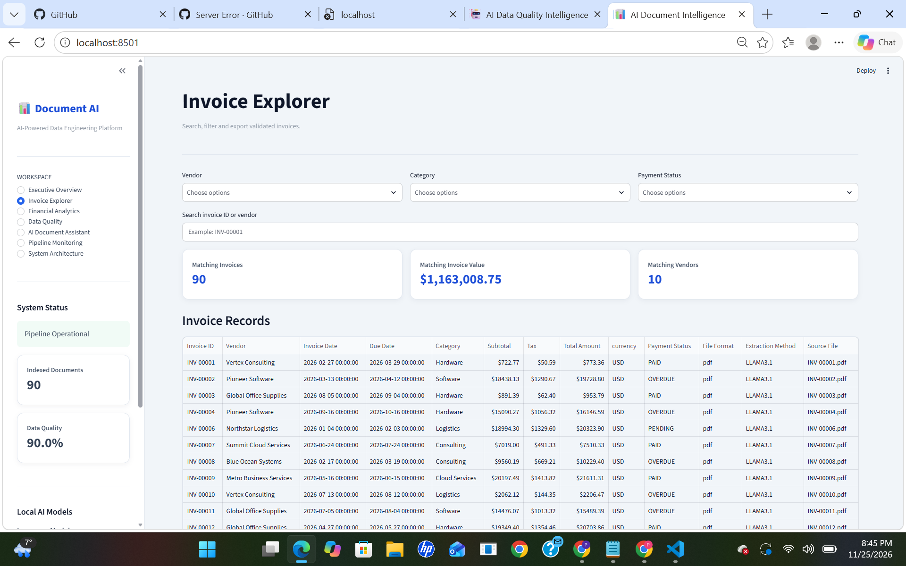
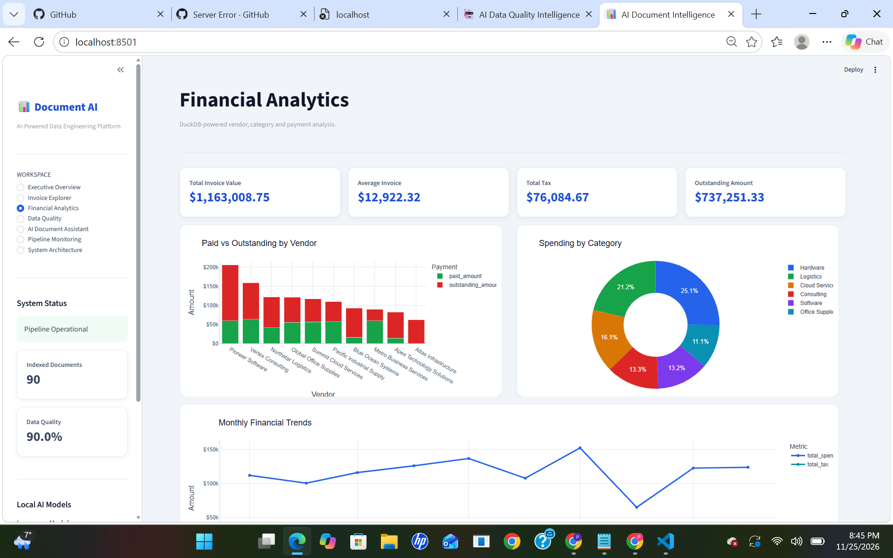
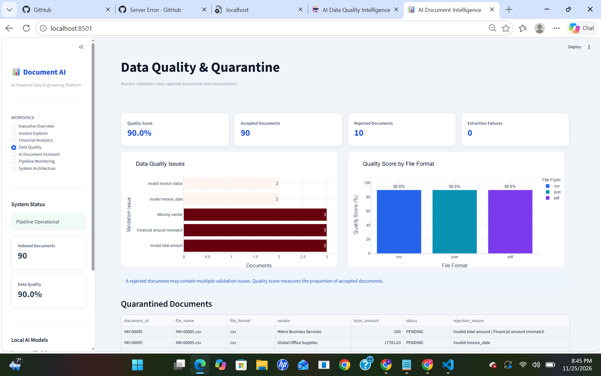
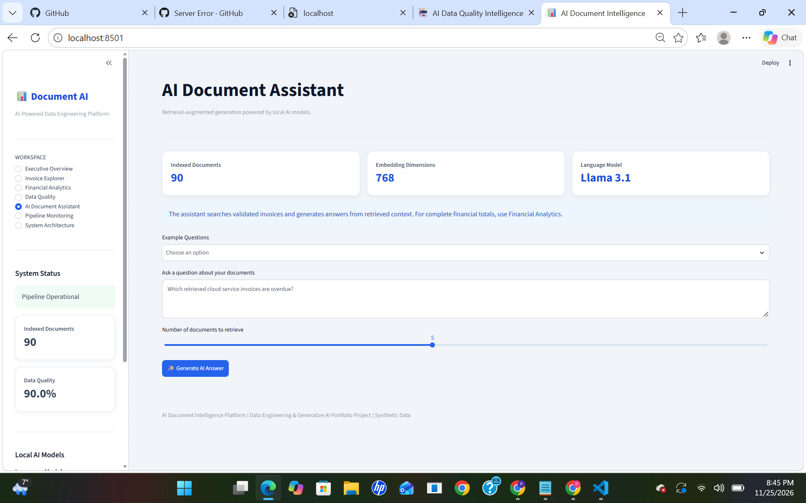
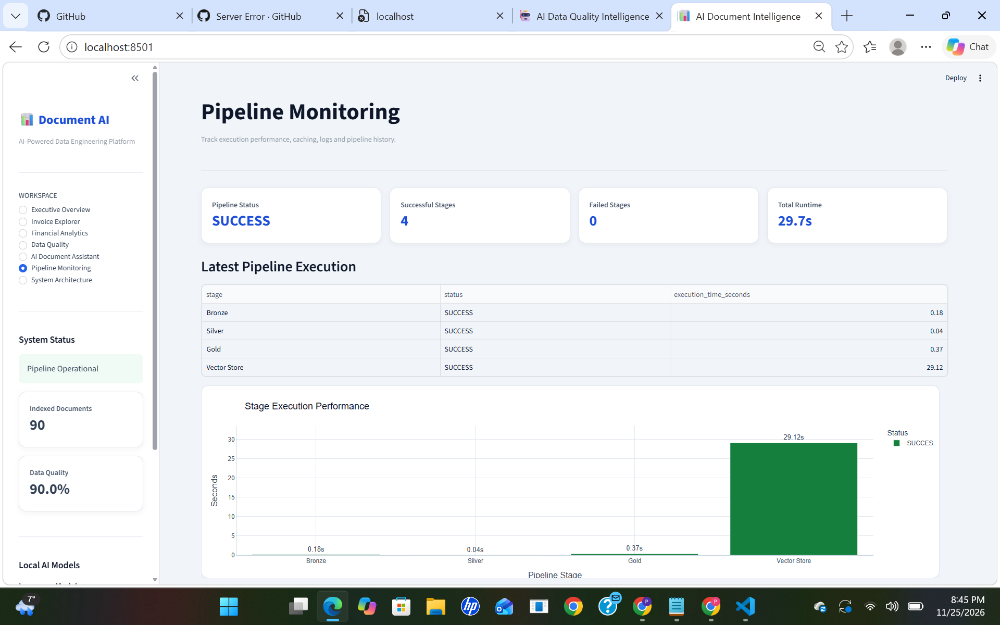
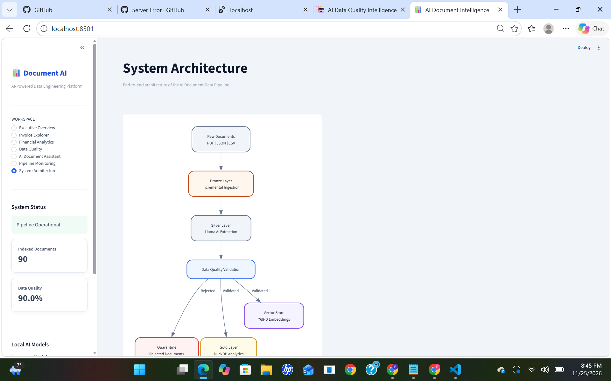
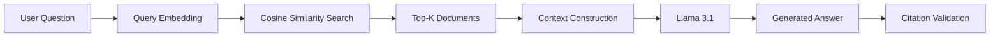

# AI Document Intelligence Platform

An end-to-end AI-powered data engineering platform that transforms
unstructured and structured invoice documents into validated,
analytics-ready datasets and searchable knowledge using local
Large Language Models (LLMs) and Retrieval-Augmented Generation (RAG).


---

## Project Overview

Organizations receive large volumes of financial documents in
multiple formats. Manually extracting, validating, and analyzing
these documents can be time-consuming and error-prone.

This project demonstrates an automated document intelligence
platform that combines modern data engineering practices with
Generative AI.

The platform ingests PDF, JSON, and CSV documents, extracts
structured invoice information using a local LLM, validates
financial data, quarantines defective records, builds an analytical
warehouse, and enables natural-language document search.

All data used in this project is synthetic.

## Key Features

- End-to-end document processing pipeline
- Bronze, Silver, and Gold medallion architecture
- Multi-format ingestion: PDF, JSON, and CSV
- SHA-256 content-based incremental ingestion
- Duplicate prevention for unchanged documents
- AI-powered PDF information extraction
- Native JSON and CSV parsing
- Content-based AI extraction caching
- Financial and business-rule validation
- Automated quarantine management
- Apache Parquet columnar storage
- DuckDB analytical warehouse
- Financial reconciliation
- Local vector embedding generation
- Semantic similarity search
- Retrieval-Augmented Generation (RAG)
- Invoice citation validation
- Dependency-aware pipeline orchestration
- Centralized logging and execution history
- Interactive seven-page Streamlit dashboard
- 50 automated Pytest checks

---

## System Architecture



### Pipeline Layers

| Layer | Responsibility |
|---|---|
| Raw | Synthetic invoice documents |
| Bronze | Document ingestion, hashing and raw text extraction |
| Silver | AI extraction, native parsing and validation |
| Quarantine | Storage of rejected documents and validation errors |
| Gold | Financial aggregations and analytical warehouse |
| Vector Store | Document embeddings and semantic retrieval |
| RAG | Context-grounded natural-language answers |
| Presentation | Interactive analytics and AI assistant |

---

## Technology Stack

| Category | Technology |
|---|---|
| Programming Language | Python |
| Data Processing | Pandas, NumPy |
| Document Processing | PyMuPDF |
| Synthetic PDF Generation | ReportLab |
| Data Storage | Apache Parquet, PyArrow |
| Analytics Warehouse | DuckDB |
| Large Language Model | Llama 3.1 8B |
| Embedding Model | Nomic Embed Text |
| Local Model Serving | Ollama |
| Vector Storage | NumPy |
| Semantic Retrieval | Cosine Similarity |
| AI Architecture | Custom RAG |
| Pipeline Orchestration | Python |
| Visualization | Streamlit, Plotly |
| Monitoring | Python Logging, JSON Reports |
| Testing | Pytest |
| Version Control | Git, GitHub |

---

## Verified Project Results

The following results were measured during local execution
using the project's synthetic invoice dataset.

| Metric | Result |
|---|---:|
| Total documents processed | 100 |
| PDF documents | 60 |
| JSON documents | 20 |
| CSV documents | 20 |
| Valid invoices | 90 |
| Rejected documents | 10 |
| Expected defective documents identified | 10/10 |
| Document acceptance rate | 90% |
| Extraction failures | 0 |
| Accepted PDF field comparisons passed | 540/540 |
| Unique vendors | 10 |
| DuckDB warehouse tables | 9 |
| Indexed documents | 90 |
| Vector embeddings | 90 |
| Embedding dimensions | 768 |
| Successful pipeline stages | 4/4 |
| Financial reconciliation checks | 4/4 |
| Dashboard pages | 7 |
| Automated tests passed | 50/50 |
| Automated test execution time | 4.30 seconds |

### Financial Analytics Results

| Financial Metric | Amount |
|---|---:|
| Total Invoice Value | $1,163,008.75 |
| Paid Amount | $425,757.42 |
| Pending Amount | $238,536.94 |
| Overdue Amount | $498,714.39 |
| Outstanding Amount | $737,251.33 |
| Total Tax | $76,084.67 |
| Average Invoice Value | $12,922.32 |

These financial values represent synthetic invoices and do not
contain real customer or organizational financial information.

---

## Pipeline Performance

### AI Extraction Caching

The Silver layer uses content-based caching to avoid repeating
expensive LLM inference for unchanged PDF documents.

| Execution | Runtime |
|---|---:|
| Initial Silver processing | 2,312.37 seconds |
| Cached Silver processing | 0.14 seconds |
| Cached documents | 60 |
| AI cache hit rate on unchanged rerun | 100% |
| Observed Silver runtime reduction | Approximately 99.99% |

The initial run performs AI extraction for all 60 PDFs.
The cached run reuses previously extracted information and
reapplies validation rules.

### End-to-End Cached Pipeline Execution

| Pipeline Stage | Runtime | Status |
|---|---:|---|
| Bronze | 0.18 seconds | SUCCESS |
| Silver | 0.04 seconds | SUCCESS |
| Gold | 0.37 seconds | SUCCESS |
| Vector Store | 29.12 seconds | SUCCESS |
| Total Pipeline | 29.70 seconds | SUCCESS |

Performance measurements are specific to the local hardware,
dataset size, model configuration, and cache state.

---

## Dashboard Screenshots

### 1. Executive Overview

Provides document processing KPIs, financial summaries,
payment distributions, monthly trends, and vendor spending.



### 2. Invoice Explorer

Supports invoice searching, vendor filtering, category filtering,
payment status filtering, and CSV export.



### 3. Financial Analytics

Provides DuckDB-powered vendor analytics, spending distributions,
payment analysis, and monthly financial trends.



### 4. Data Quality and Quarantine

Displays document acceptance rates, validation issues,
rejected records, and financial reconciliation results.



### 5. AI Document Assistant

Enables natural-language document search using vector embeddings,
semantic similarity retrieval, and local LLM inference.



### 6. Pipeline Monitoring

Tracks execution status, stage-level runtime, cache utilization,
pipeline history, and application logs.



### 7. System Architecture

Visualizes the document processing architecture and technology stack.



---

## Data Quality Framework

The Silver layer validates extracted invoice records using
business and financial validation rules.

### Validation Rules

- Required field validation
- Invoice identifier validation
- Vendor name validation
- Positive subtotal and total amount
- Non-negative tax amount
- Financial amount reconciliation
- Valid invoice and due dates
- Due date greater than or equal to invoice date
- Valid payment status
- USD currency validation

### Detected Data Quality Issues

| Validation Issue | Affected Documents |
|---|---:|
| Missing vendor | 3 |
| Invalid total amount | 3 |
| Financial amount mismatch | 3 |
| Invalid invoice date | 2 |
| Invalid invoice status | 2 |

A rejected document may contain multiple validation issues.
The dataset includes 10 intentionally defective documents.

All 10 expected defective documents were successfully quarantined.

---

## Gold Analytics Warehouse

The Gold layer creates nine DuckDB tables for analytical
queries and dashboard consumption.

| Table | Purpose |
|---|---|
| invoices | Validated invoice records |
| rejected_invoices | Quarantined invoice records |
| vendor_summary | Vendor-level financial aggregations |
| category_summary | Category-level spending |
| status_summary | Payment status analysis |
| monthly_summary | Monthly financial trends |
| format_summary | Document format processing metrics |
| quality_summary | Data quality issue aggregations |
| pipeline_kpis | Executive dashboard metrics |

### Example Analytical SQL

```sql
SELECT
    vendor,
    COUNT(*) AS invoice_count,
    ROUND(SUM(total_amount), 2) AS total_spend
FROM invoices
GROUP BY vendor
ORDER BY total_spend DESC;
```

```sql
SELECT
    category,
    COUNT(*) AS overdue_invoices,
    ROUND(SUM(total_amount), 2) AS overdue_amount
FROM invoices
WHERE status = 'OVERDUE'
GROUP BY category
ORDER BY overdue_amount DESC;
```

---

## Retrieval-Augmented Generation

The AI Document Assistant uses a custom RAG workflow.



### RAG Configuration

| Component | Configuration |
|---|---|
| Language Model | llama3.1:8b |
| Embedding Model | nomic-embed-text |
| Vector Dimensions | 768 |
| Indexed Documents | 90 |
| Similarity Algorithm | Cosine Similarity |
| Default Retrieval Count | 5 |
| Model Serving | Local Ollama |

### Example Question

> Find overdue invoices related to cloud services.

### Example Retrieved Answer

| Invoice ID | Vendor | Amount |
|---|---|---:|
| INV-00063 | Atlas Infrastructure | $11,276.41 |
| INV-00069 | Metro Business Services | $7,699.92 |
| INV-00100 | Atlas Infrastructure | $11,560.50 |

Citation validation: PASS

The answer was generated from five retrieved documents.
Citation validation confirms that referenced invoice identifiers
exist in the retrieved context.

RAG results are limited to retrieved documents and should not
be treated as exhaustive financial queries. Complete financial
aggregations are handled by DuckDB.

---

## Project Structure

```text
ai-document-data-pipeline/
|
|-- .streamlit/
|   |-- config.toml
|
|-- data/
|   |-- raw/
|   |   |-- pdf/
|   |   |-- json/
|   |   |-- csv/
|   |-- bronze/
|   |-- silver/
|   |-- gold/
|   |-- quarantine/
|   |-- vector_store/
|
|-- logs/
|-- reports/
|
|-- screenshots/
|   |-- 01_executive_overview.png
|   |-- 02_invoice_explorer.png
|   |-- 03_financial_analytics.png
|   |-- 04_data_quality.png
|   |-- 05_ai_assistant.png
|   |-- 06_pipeline_monitoring.png
|   |-- 07_system_architecture.png
|
|-- tests/
|   |-- test_pipeline.py
|
|-- generate_documents.py
|-- bronze.py
|-- silver.py
|-- gold.py
|-- vector_store.py
|-- rag_engine.py
|-- pipeline.py
|-- app.py
|-- requirements.txt
|-- .gitignore
|-- README.md
```

Generated datasets, databases, embeddings, caches, reports,
and logs are excluded from version control.

---

## Installation and Setup

### Prerequisites

- Python 3.14 (tested with Python 3.14.3)
- Git
- Ollama
- Sufficient local memory to run Llama 3.1 8B

The project was developed and tested on Windows.

### 1. Clone the Repository

```bash
git clone https://github.com/palvp1/ai-document-data-pipeline.git
cd ai-document-data-pipeline
```

### 2. Create a Virtual Environment

```cmd
python -m venv .venv
```

Activate on Windows Command Prompt:

```cmd
.venv\Scripts\activate
```

### 3. Install Dependencies

```bash
python -m pip install -r requirements.txt
```

### 4. Install Ollama Models

Install Ollama from:

https://ollama.com/download

Ensure the local Ollama service is running.

Download the required models:

```bash
ollama pull llama3.1:8b
ollama pull nomic-embed-text
```

Verify the models:

```bash
ollama list
```

### 5. Generate Synthetic Documents

```bash
python generate_documents.py
```

This creates 100 synthetic invoice documents, including
10 intentionally defective records.

### 6. Execute the Data Pipeline

```bash
python pipeline.py
```

The orchestrator executes:

1. Bronze ingestion
2. Silver extraction and validation
3. Gold warehouse creation
4. Vector embedding generation

The initial execution may take considerable time because
of local LLM inference. Subsequent unchanged runs benefit
from incremental ingestion and AI extraction caching.

### 7. Execute the RAG Assistant

```bash
python rag_engine.py
```

Run a document question and generate the RAG execution report
before executing the automated tests.

### 8. Launch the Dashboard

```bash
streamlit run app.py
```

Open the application at:

http://localhost:8501

### 9. Run Automated Tests

After generating the documents, completing the pipeline,
and executing the RAG assistant:

```bash
python -m pytest tests/test_pipeline.py -v
```

---

## Automated Testing

The project includes 50 automated checks covering
data processing, validation, source fidelity, financial
reconciliation, vector integrity, and execution reports.

| Test Category | Tests Passed |
|---|---:|
| Bronze ingestion | 6/6 |
| Silver processing | 11/11 |
| Quarantine and reconciliation | 6/6 |
| AI source accuracy | 4/4 |
| Gold analytics warehouse | 8/8 |
| Vector store | 9/9 |
| Pipeline reports | 5/5 |
| RAG citation validation report | 1/1 |
| Total | 50/50 |

### Observed Test Results

```text
============================= test session starts =============================
collected 50 items

============================== 50 passed in 4.30s =============================
```

Source accuracy checks compared all ten extracted fields
from 54 accepted PDF invoices against their original text.

The tests validate the generated synthetic dataset and
pipeline artifacts. They do not establish general-purpose
LLM extraction accuracy or production readiness.

---

## Engineering Concepts Demonstrated

- ETL and ELT workflows
- Medallion data architecture
- Structured and unstructured data processing
- Incremental ingestion
- Content-based hashing
- Idempotent processing of unchanged inputs
- Columnar storage
- Data quality management
- Financial reconciliation
- Analytical data modeling
- SQL aggregation
- LLM information extraction
- AI inference optimization
- Vector embeddings
- Semantic search
- Retrieval-Augmented Generation
- Pipeline orchestration
- Observability and monitoring
- Automated regression testing
- Interactive business intelligence

---

## Limitations and Future Enhancements

This project is a local proof of concept built using
synthetic, text-based invoice documents.

Potential future enhancements include:

- OCR for scanned documents
- Support for additional document layouts
- Apache Airflow orchestration
- Cloud object storage integration
- Managed vector database integration
- Metadata-filtered hybrid retrieval
- Automated RAG evaluation
- CI/CD with GitHub Actions
- Docker containerization
- Role-based access control
- Production-grade secrets management
- Distributed processing for larger datasets

---

## Author

Data Engineering and Generative AI Portfolio Project

GitHub: https://github.com/palvp1

---

## Disclaimer

This repository is an independent educational portfolio project.
All documents and financial records are synthetic.

No proprietary enterprise systems, confidential information,
or real customer financial records are used.